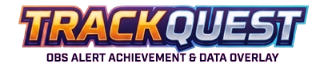

<p align="center">
  
</p>

<h1 align="center">🎮 TrackQuest</h1>

<p align="center">
  <b>Overlay de conquistas do RetroAchievements para OBS Studio.</b>
</p>

<p align="center">
  
  
</p>

Acompanhe suas conquistas, progresso, grade de badges e objetivos em tempo real durante suas lives e gravações — tudo dentro de uma fonte de navegador no OBS.

---

## ✨ Funcionalidades

- **🏆 Alerta de conquista** — pop-up animado com badge, título, descrição, pontos e barra de tempo
- **⭐ Banner de masterização** — alerta especial + chuva de badges quicando pela tela ao masterizar (100% hardcore)
- **📊 Painel de progresso** — card fixo com ícone do jogo, barra de progresso, contagem, Rich Presence e tempo jogado
- **🧩 Grade de badges** — painel visual com todas as conquistas; badges desbloqueadas ganham animação de cabeçada com personagem
- **🎯 Painel de objetivo** — mostra a conquista que você está tentando fazer, com fila, avanço automático e faixa de texto rolante
- **🌐 Tradução automática** — traduz os objetivos para Português, Espanhol, Francês, Alemão ou Italiano
- **🎨 Menu com 6 abas** — Geral, Alerta, Painel de dados, Objetivo, Conquistas e Bolinhas
- **✨ Efeitos de borda** — Neon, Pulsar e Luz circulando com 6 cores à escolha
- **🔊 Sons customizáveis** — use seus próprios arquivos de som ou o beep retrô embutido
- **🧲 Ímã inteligente** — painéis grudam nas bordas da tela e entre si ao arrastar (segure Alt para soltar)

---

## 🚀 Instalação

### 1. Obtenha sua API Key do RetroAchievements

1. Acesse [retroachievements.org](https://retroachievements.org) e faça login
2. Vá em **Settings → Keys** e copie sua **Web API Key**

### 2. Adicione ao OBS

1. No OBS, adicione uma fonte do tipo **Navegador** (Browser Source)
2. Marque **"Arquivo local"** e selecione o arquivo `tracker-obs.html`
3. Defina a resolução para o tamanho da sua cena (ex.: 1920×1080)
4. Marque **"Interagir com a página quando não estiver ativa"** (opcional, para o modo edição)

### 3. Configure o usuário

Há duas formas de informar suas credenciais:

**Opção A — Pelo modo edição (recomendado):**
1. Clique com o botão direito na fonte → **Interagir**
2. Pressione `E` para entrar no modo edição
3. Na aba **Geral** → seção **Conta RetroAchievements**
4. Preencha seu usuário e API Key e clique em **Salvar e conectar**

**Opção B — Pela URL:**
```
tracker-obs.html?user=SeuUsuario&key=SuaApiKey
```

---

## ⌨️ Atalhos (janela Interagir do OBS)

| Tecla | Ação |
|:-----:|------|
| `E` | Entrar / sair do modo edição |
| `T` | Testar alerta de conquista |
| `M` | Testar banner de masterização |
| `G` | Testar desbloqueio na grade (cabeçada) |
| `B` | Testar bolinhas de masterização |
| `R` | Restaurar layout (reset) — só no modo edição |

---

## 🎨 Modo Edição

Ao pressionar `E` na janela **Interagir** do OBS, o menu com 6 abas aparece no topo. Você pode:

- **Arrastar** os painéis (alerta, progresso, objetivo e grade) para qualquer posição — eles **grudam** nas bordas e entre si (segure `Alt` para soltar)
- **Redimensionar** usando o canto branco ou a roda do mouse
- **Ajustar a largura** arrastando a alça lateral
- **Mover o menu** arrastando pela área de ajuda no topo

### Abas do menu

| Aba | O que configura |
|-----|-----------------|
| **Geral** | Presets prontos, sons e conta do RetroAchievements |
| **Alerta** | Entrada (slide/zoom/cair/girar/surgir), brilho e borda |
| **Painel de dados** | Exibir/ocultar, tempo jogado (H:MM / H:MM:SS), temas de cor, luz do ícone, piscada e efeitos de borda |
| **Objetivo** | Estilo, faixa de texto (rolagem, fundo, cores), tradução, fontes em px, fila de objetivos e efeitos de borda |
| **Conquistas** | Exibir/ocultar, tamanho/espaço dos badges, filtro (todas/bloqueadas/ganhas), ordem, fundo, borda, estilo dos badges, animação da cabeçada e personagem |
| **Bolinhas** | Ligar/desligar, quantidade, tamanho, duração, velocidade, gravidade (nenhuma/leve/forte), borda e cor |

### Estilos prontos (Presets)

| Preset | Descrição |
|--------|-----------|
| **Arcade** | Slide + reflexo + neon (padrão) |
| **Clean** | Fade suave + bordas arredondadas + tema escuro |
| **Minimalista** | Sem bordas, sem brilho, fundo transparente |
| **Neon** | Zoom + pulsar + bordas neon girando |

### Efeitos de borda (Objetivo, Progresso e Grade)

| Efeito | Descrição |
|--------|-----------|
| **Nenhum** | Borda normal |
| **Neon** | Brilho fixo colorido |
| **Pulsar** | Brilho pulsante |
| **Luz circulando** | Faixa de luz que gira ao redor do painel |

> Cores disponíveis: Ciano · Rosa · Verde · Dourado · Vermelho · Branco

### Temas do painel de progresso

| Tema | Cores |
|------|-------|
| **Neon** | Azul ciano (padrão) |
| **Fogo** | Laranja e vermelho |
| **Verde** | Verde esmeralda |
| **Rosa** | Rosa e magenta |
| **Escuro** | Cinza escuro com dourado |

---

## 🎯 Sistema de Objetivos

O painel de objetivo mostra a conquista que você está tentando conseguir:

1. No modo edição, aba **Objetivo** → **Escolher objetivo**
2. Clique nas conquistas pendentes para adicionar à fila (a ordem dos cliques define a prioridade)
3. Clique novamente para remover da fila
4. A primeira conquista não obtida da fila aparece no painel
5. Ao conquistar, o painel mostra **"✓ Concluída!"** e avança para a próxima

### Recursos do painel de objetivo

- **Faixa de texto rolante** — o rótulo rola quando o texto não cabe (configurável: automática, sempre ou desligada)
- **Fundo personalizado** — Translúcido, Escuro, Fogo, Azul, Verde, Roxo ou cores personalizadas (#hex)
- **Tradução automática** — traduz título e descrição para 6 idiomas usando MyMemory (resultado é cacheado)
- **Fontes ajustáveis em px** — rótulo, título, descrição e dados podem ser ajustados individualmente
- **Estilos do painel** — Translúcido · Escuro sólido · Claro · Neon · Minimalista

A fila é salva por jogo no `localStorage` e persiste entre sessões.

---

## 🧩 Grade de Badges

Painel visual com todas as conquistas do jogo atual:

- **Badges bloqueadas** — efeito blur, cinza, escurecidas ou sem efeito
- **Desbloqueio animado** — um personagem corre, dá uma cabeçada e a badge sobe (pode desligar)
- **Personagem customizável** — troque o arquivo `Assets/img/runner.png` por qualquer pixel art
- **Filtros** — mostrar todas, só bloqueadas ou só desbloqueadas
- **Ordenação** — ordem do jogo, mais pontos ou mais raras
- **Borda dos badges** — cor (7 opções), espessura (fina/normal/grossa/neon/sem borda) e cantos (suaves/retos/arredondados)
- **Tamanho, espaço e altura máxima** ajustáveis em px

---

## 🫧 Bolinhas de Masterização

Ao masterizar um jogo, as badges das conquistas saem em bolinhas que quicam pela tela com física real:

- **Colisão elástica** entre bolinhas
- **Gravidade** — nenhuma, leve ou forte
- **Configuráveis** — quantidade (4–150), tamanho (24–160 px), duração (3–60 s), velocidade (100–1200 px/s)
- **Borda** — fina, grossa, neon ou sem borda, com 6 cores

---

## 🔊 Sons

O overlay toca um som a cada conquista desbloqueada e outro na masterização.

### Sons da pasta (padrão)

Coloque os arquivos na pasta `Assets/sound/`:

| Arquivo | Evento |
|---------|--------|
| `conquista.ogg` (ou `.mp3` / `.wav`) | Conquista desbloqueada |
| `masterizado.ogg` (ou `.mp3` / `.wav`) | Jogo masterizado |

Se nenhum arquivo for encontrado, um **beep retrô** é gerado automaticamente.

### Sons enviados pelo menu

No modo edição → aba **Geral** → seção **Sons**, você pode enviar seus próprios arquivos de som. Eles ficam salvos no IndexedDB do navegador e têm prioridade sobre os da pasta.

---

## ⚙️ Parâmetros de URL

Todos os parâmetros são opcionais. Valores informados na URL têm prioridade sobre os salvos.

| Parâmetro | Padrão | Descrição |
|-----------|--------|-----------|
| `user` | `blumzeira` | Usuário do RetroAchievements |
| `key` | — | Web API Key |
| `poll` | `8` | Intervalo de checagem de conquistas (segundos) |
| `time` | `7` | Duração do alerta na tela (segundos) |
| `pos` | `bl` | Posição do alerta: `tl` · `tr` · `bl` · `br` |
| `ppos` | `tl` | Posição do painel de progresso |
| `gpos` | `br` | Posição do painel de conquistas (grade) |
| `opos` | `tr` | Posição do painel de objetivo |
| `progress` | `1` | `0` para esconder o card de progresso |
| `sound` | `1` | `0` para silenciar |
| `hc` | `0` | `1` para alertar apenas conquistas hardcore |
| `scale` | `1` | Escala dos painéis (ex.: `1.25`) |
| `vol` | `0.8` | Volume dos sons (0 a 1) |
| `demo` | `0` | `1` para modo demonstração (sem API) |
| `debug` | `0` | `1` para exibir avisos de som nos testes |
| `sfx` | — | Caminho personalizado do som de conquista |
| `sfxmaster` | — | Caminho personalizado do som de masterização |

**Exemplo completo:**
```
tracker-obs.html?user=MeuUsuario&key=MinhaApiKey&pos=bl&ppos=tl&gpos=br&opos=tr&scale=1.1&hc=1
```

---

## 📁 Estrutura do Projeto

```
Track-Quest/
├── index.html              → Landing page (GitHub Pages)
├── tracker-obs.html        → Página do overlay (fonte de navegador do OBS)
├── css/
│   └── style.css           → Estilos e animações
├── js/
│   └── app.js              → Lógica: API, alertas, edição, objetivos, grade, bolinhas e sons
├── Assets/
│   ├── img/
│   │   ├── Logo-trackQuest.png
│   │   └── runner.png      → Personagem da animação de cabeçada (pixel art)
│   └── sound/              → Sons de conquista e masterização (.ogg/.mp3/.wav)
└── README.md
```

---

## 🔗 APIs utilizadas

O overlay consome a [API pública do RetroAchievements](https://api-docs.retroachievements.org/):

| Endpoint | Uso |
|----------|-----|
| `API_GetUserRecentAchievements` | Conquistas recentes (polling) |
| `API_GetUserProfile` | Perfil e jogo atual |
| `API_GetGameInfoAndUserProgress` | Progresso detalhado, lista de conquistas e tempo jogado |

Para tradução dos objetivos, usa a [API gratuita MyMemory](https://mymemory.translated.net/doc/spec.php) (resultados cacheados no `localStorage`).

---

## 📝 Notas

- O overlay foi feito para rodar como **fonte de navegador** no OBS. Funciona também em qualquer navegador moderno para testes.
- As posições, escalas, efeitos, fontes e credenciais são salvos no `localStorage` do navegador.
- Sons enviados pelo menu são armazenados no `IndexedDB`.
- Traduções dos objetivos são cacheadas no `localStorage` para não repetir chamadas.
- Na primeira execução, conquistas já obtidas não disparam alertas (evita flood).
- A masterização é detectada automaticamente quando o progresso hardcore chega a 100%.
- O personagem da cabeçada (`Assets/img/runner.png`) pode ser substituído por qualquer pixel art — de preferência virada para a direita, com ~44 px de largura.

---

## 📄 Licença

Projeto pessoal de [Blumzeira](https://retroachievements.org/user/blumzeira).

---

<p align="center">
  <b>TrackQuest</b> · v1.2 · 2026
</p>
